# VentureScope - captions for every picture

<!-- Made by pnpm portfolio:texts. To change the text, edit portfolio/profile.json or scripts/portfolio/pages.json and run the command again. -->

## Public pages

### 1. Landing page
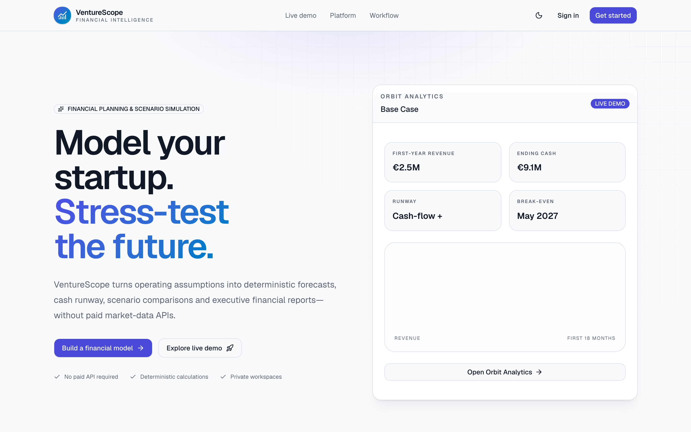
- **File:** screenshots/desktop/01-landing.png
- **Page:** /
- **Caption:** The public home page: what VentureScope does and how a plan becomes a forecast, a scenario and a report.
- **What to notice:** The headline, the platform cards and the promise of a free stack with no paid APIs.
- **Alt text:** Landing page in VentureScope. The public home page: what VentureScope does and how a plan becomes a forecast, a scenario and a report.
- **Other versions:** [Dark theme](../screenshots/dark/01-landing.png), [Phone](../screenshots/mobile/01-landing.png), [Full page](../screenshots/desktop/01-landing-full.png)

### 2. Live demo
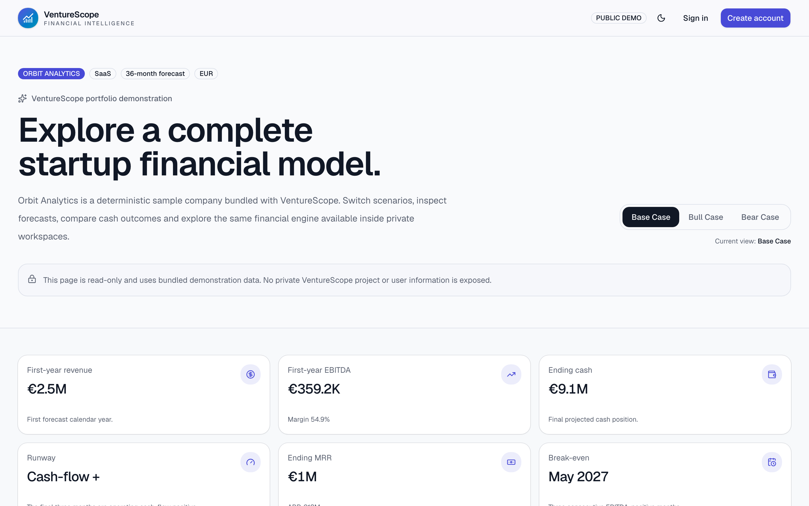
- **File:** screenshots/desktop/02-live-demo.png
- **Page:** /demo
- **Caption:** A read-only tour of the Orbit Analytics sample company, with Base, Bull and Bear scenarios and no sign-up.
- **What to notice:** Switch the scenario tabs and watch the charts and tables change.
- **Alt text:** Live demo in VentureScope. A read-only tour of the Orbit Analytics sample company, with Base, Bull and Bear scenarios and no sign-up.
- **Other versions:** [Dark theme](../screenshots/dark/02-live-demo.png), [Full page](../screenshots/desktop/02-live-demo-full.png)

### 3. Help center
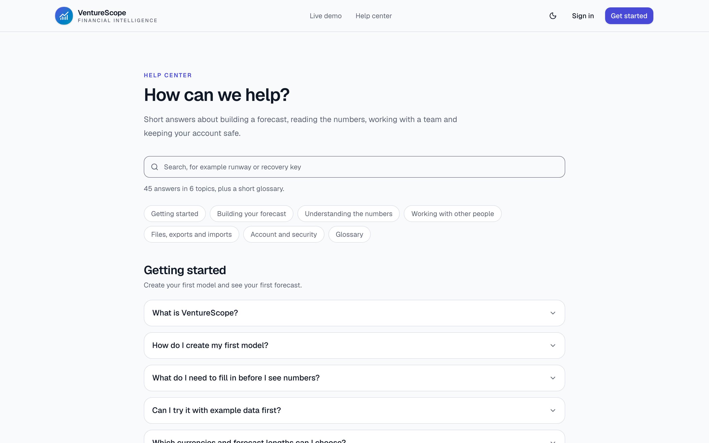
- **File:** screenshots/desktop/03-help.png
- **Page:** /help
- **Caption:** Answers, key terms and how the numbers work, in plain English.
- **What to notice:** The help page is open to everyone, even before sign-in.
- **Alt text:** Help center in VentureScope. Answers, key terms and how the numbers work, in plain English.
- **Other versions:** none

### 4. Privacy notice
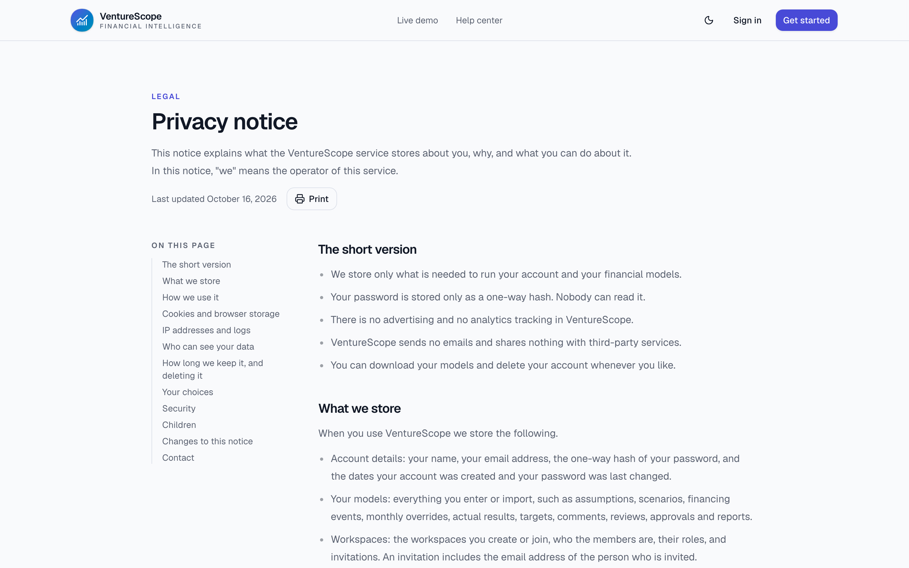
- **File:** screenshots/desktop/04-privacy.png
- **Page:** /privacy
- **Caption:** What VentureScope stores and why.
- **What to notice:** Short sections in plain words, with the date of the last update.
- **Alt text:** Privacy notice in VentureScope. What VentureScope stores and why.
- **Other versions:** none

### 5. Terms
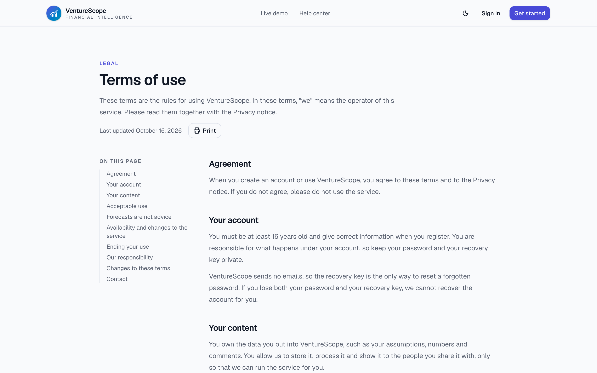
- **File:** screenshots/desktop/05-terms.png
- **Page:** /terms
- **Caption:** The rules for using VentureScope.
- **What to notice:** Same layout as the privacy notice, so both documents read the same way.
- **Alt text:** Terms in VentureScope. The rules for using VentureScope.
- **Other versions:** none

### 6. Sign in
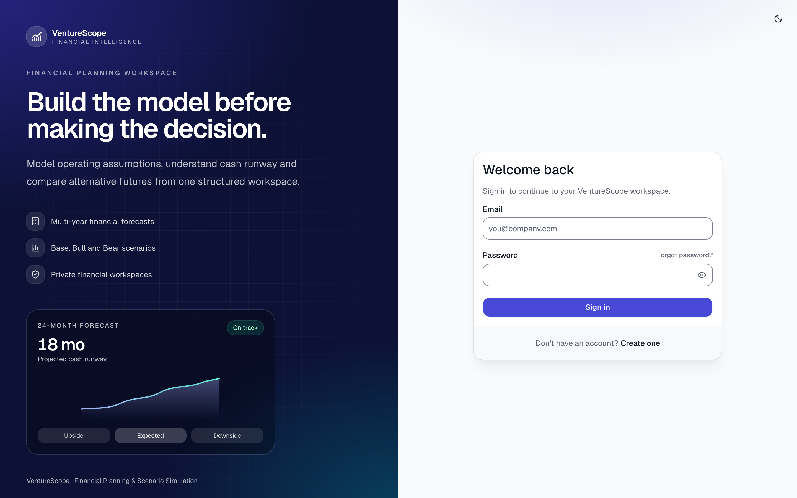
- **File:** screenshots/desktop/06-sign-in.png
- **Page:** /login
- **Caption:** Email and password sign-in that sends you back to the page you asked for.
- **What to notice:** A show-password button, and a Forgot password link that leads to the recovery-key reset.
- **Alt text:** Sign in in VentureScope. Email and password sign-in that sends you back to the page you asked for.
- **Other versions:** [Dark theme](../screenshots/dark/06-sign-in.png), [Phone](../screenshots/mobile/06-sign-in.png)

### 7. Create an account
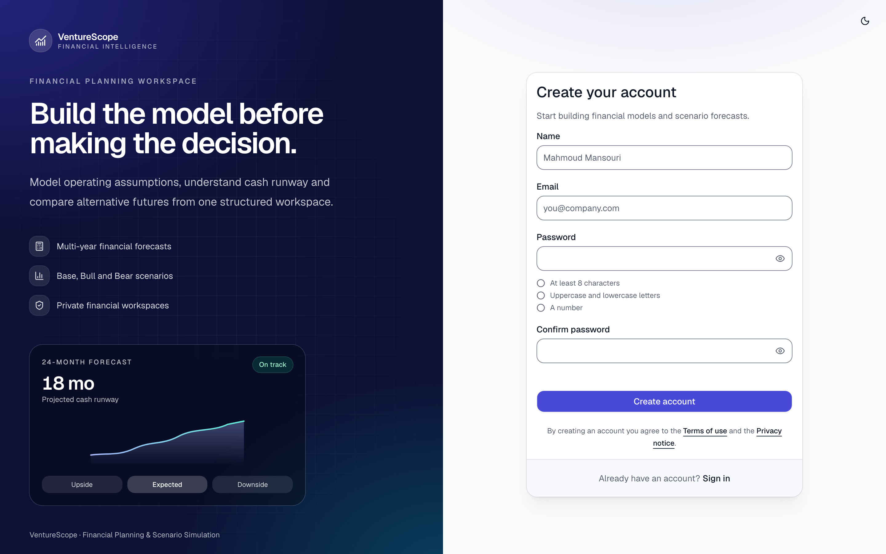
- **File:** screenshots/desktop/07-register.png
- **Page:** /register
- **Caption:** Registration with a name, an email and a password that is typed twice.
- **What to notice:** Each field shows its own clear message when something is wrong.
- **Alt text:** Create an account in VentureScope. Registration with a name, an email and a password that is typed twice.
- **Other versions:** none

### 8. Forgot password
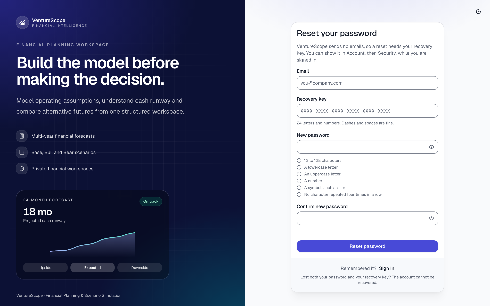
- **File:** screenshots/desktop/08-forgot-password.png
- **Page:** /forgot-password
- **Caption:** Password reset without any email: enter your email, your saved recovery key and a new password.
- **What to notice:** VentureScope sends no emails, so the recovery key replaces the usual reset link.
- **Alt text:** Forgot password in VentureScope. Password reset without any email: enter your email, your saved recovery key and a new password.
- **Other versions:** none

### 9. Page not found
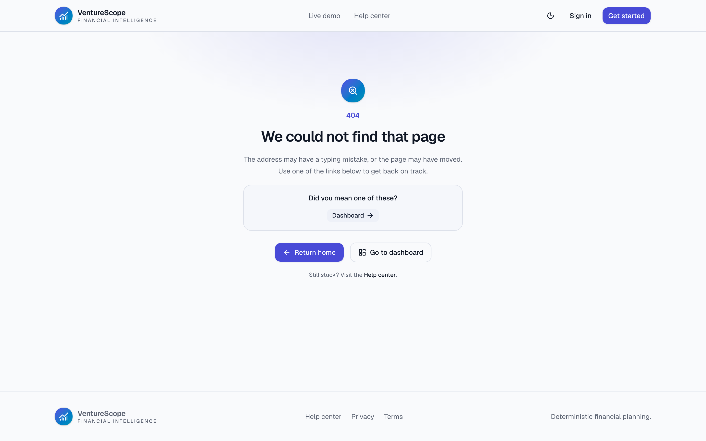
- **File:** screenshots/desktop/09-not-found.png
- **Page:** /dashbord
- **Caption:** A not-found page that helps: it explains what happened and offers ways to go on.
- **What to notice:** No dead end: links and suggestions instead of an empty error.
- **Alt text:** Page not found in VentureScope. A not-found page that helps: it explains what happened and offers ways to go on.
- **Other versions:** none

## App shell

### 10. Dashboard
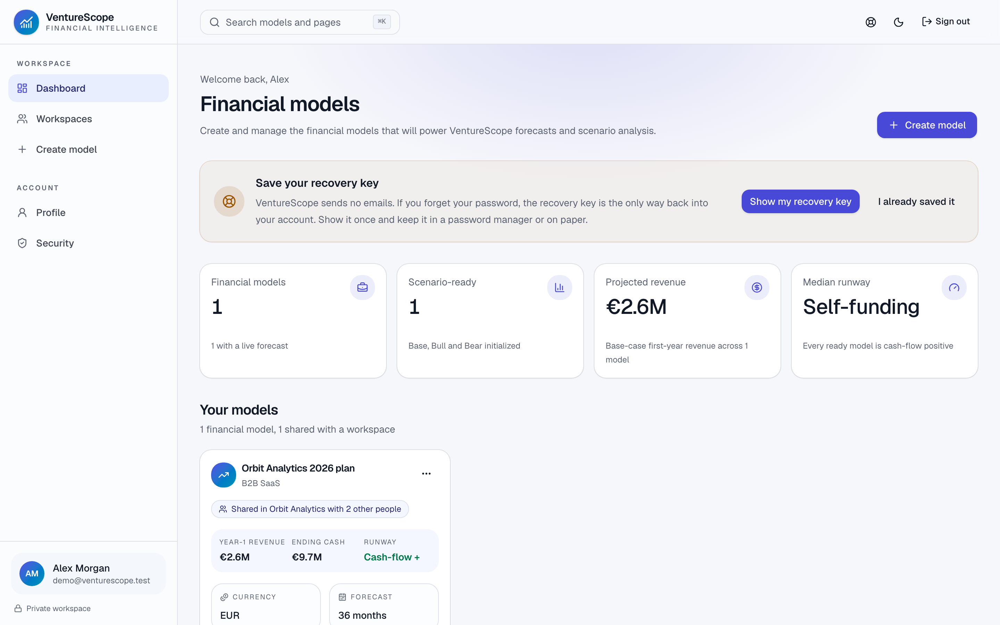
- **File:** screenshots/desktop/10-dashboard.png
- **Page:** /dashboard
- **Caption:** The home of a signed-in person: every financial model with live portfolio numbers and a needs-attention panel.
- **What to notice:** Model cards, portfolio KPIs and attention items marked Critical, Watch or Setup.
- **Alt text:** Dashboard in VentureScope. The home of a signed-in person: every financial model with live portfolio numbers and a needs-attention panel.
- **Other versions:** [Dark theme](../screenshots/dark/10-dashboard.png), [Phone](../screenshots/mobile/10-dashboard.png), [Full page](../screenshots/desktop/10-dashboard-full.png)

### 11. Search with Ctrl/Cmd + K
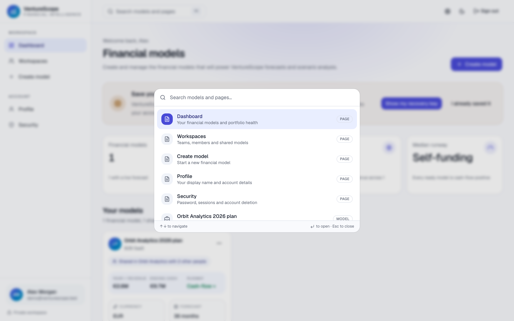
- **File:** screenshots/desktop/11-command-palette.png
- **Page:** /dashboard
- **Caption:** Press Ctrl or Cmd + K anywhere in the app to jump to a model or a page.
- **What to notice:** Models, workspace pages and help pages in one list that works with the arrow keys and Enter.
- **Alt text:** Search with Ctrl/Cmd + K in VentureScope. Press Ctrl or Cmd + K anywhere in the app to jump to a model or a page.
- **Other versions:** none

### 12. Mobile menu
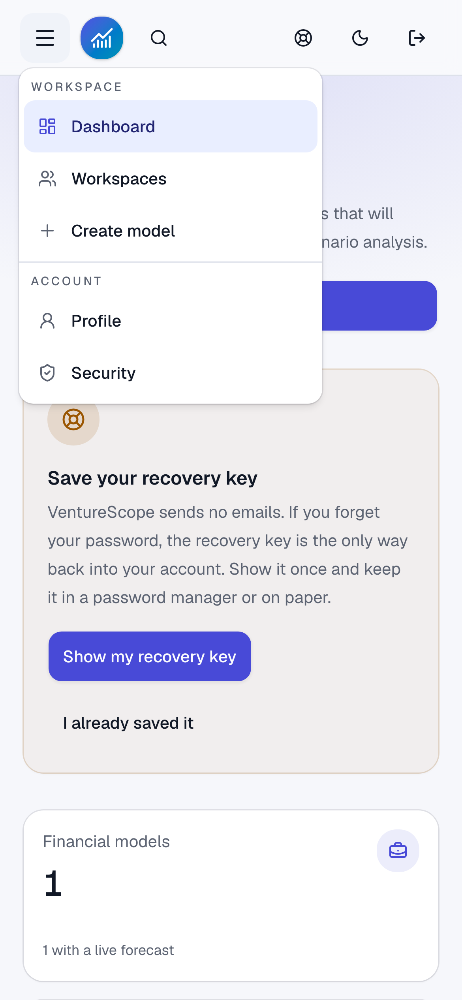
- **File:** screenshots/mobile/12-mobile-menu.png
- **Page:** /dashboard
- **Caption:** On a phone the side menu becomes a menu button, and every page stays reachable.
- **What to notice:** Workspace and account links in one drop-down menu.
- **Alt text:** Mobile menu in VentureScope. On a phone the side menu becomes a menu button, and every page stays reachable.
- **Other versions:** [Phone](../screenshots/mobile/12-mobile-menu.png)

### 13. Workspaces
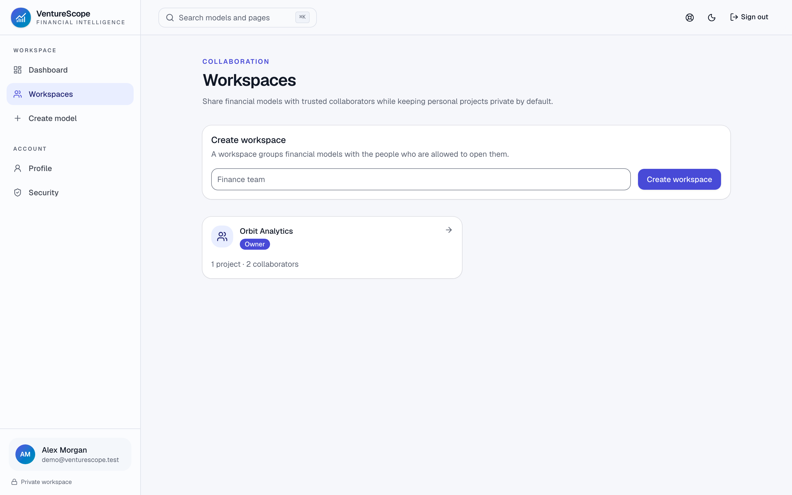
- **File:** screenshots/desktop/13-workspaces.png
- **Page:** /workspaces
- **Caption:** Teams and shared models: create a workspace, accept invitations and see the workspaces you belong to.
- **What to notice:** Owner, editor and viewer roles decide who can change what.
- **Alt text:** Workspaces in VentureScope. Teams and shared models: create a workspace, accept invitations and see the workspaces you belong to.
- **Other versions:** none

### 14. Workspace detail
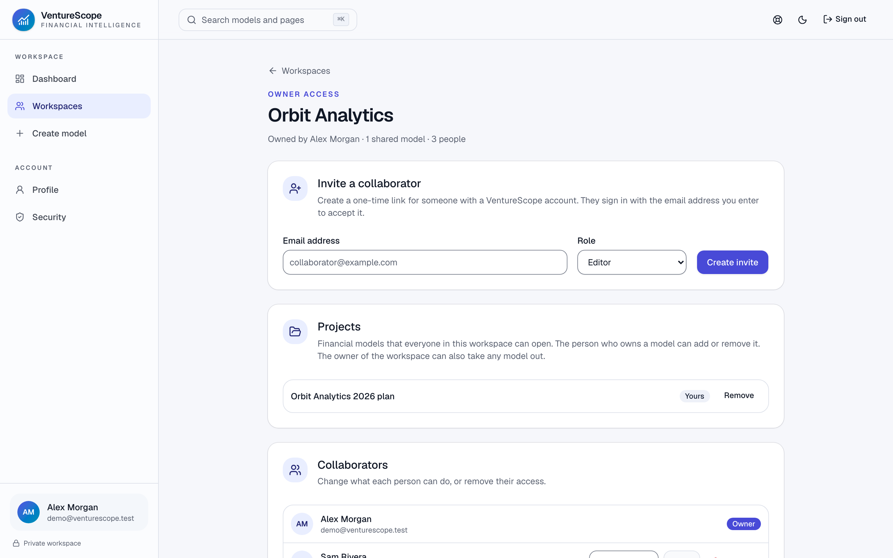
- **File:** screenshots/desktop/14-workspace.png
- **Page:** /workspaces/:workspace
- **Caption:** One workspace with its shared models, its collaborators and roles, invitation links and owner actions.
- **What to notice:** Invitation links are one-time links that work for 7 days.
- **Alt text:** Workspace detail in VentureScope. One workspace with its shared models, its collaborators and roles, invitation links and owner actions.
- **Other versions:** none

### 15. Create a model
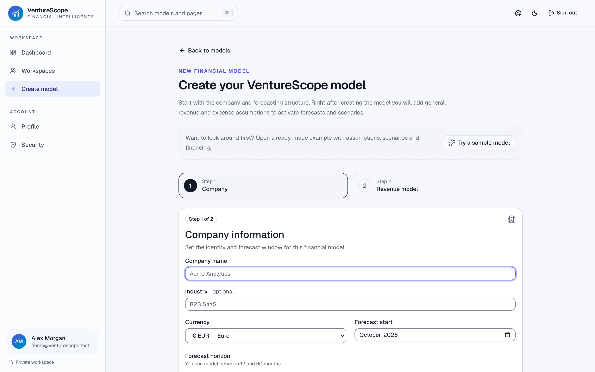
- **File:** screenshots/desktop/15-new-model.png
- **Page:** /projects/new
- **Caption:** Start a model with company, industry, currency and forecast horizon, open a ready-made example, or restore a backup.
- **What to notice:** Base, Bull and Bear scenarios are created automatically.
- **Alt text:** Create a model in VentureScope. Start a model with company, industry, currency and forecast horizon, open a ready-made example, or restore a backup.
- **Other versions:** none

### 16. Profile
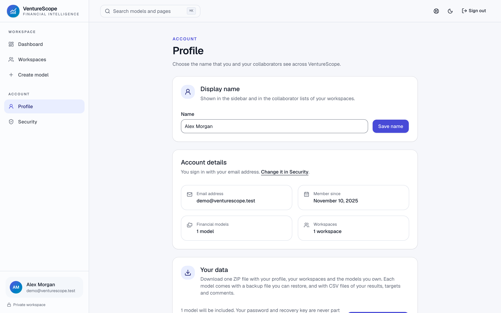
- **File:** screenshots/desktop/16-profile.png
- **Page:** /account/profile
- **Caption:** Your display name and account details, and the button to download all of your data.
- **What to notice:** Download my data returns one ZIP file with your models as JSON and CSV.
- **Alt text:** Profile in VentureScope. Your display name and account details, and the button to download all of your data.
- **Other versions:** none

### 17. Account security
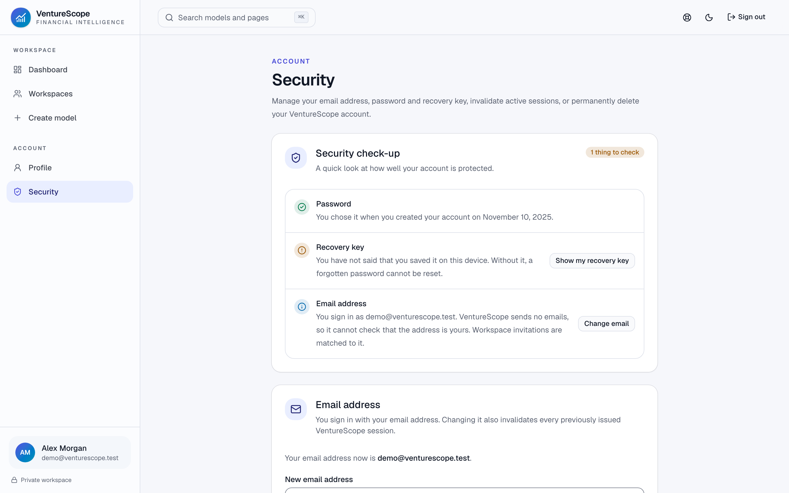
- **File:** screenshots/desktop/17-security.png
- **Page:** /account/security
- **Caption:** Email, password, recovery key, active sessions and account deletion in one place.
- **What to notice:** A security check-up card gives three plain facts about the account.
- **Alt text:** Account security in VentureScope. Email, password, recovery key, active sessions and account deletion in one place.
- **Other versions:** none

## Model inputs

### 18. Model overview
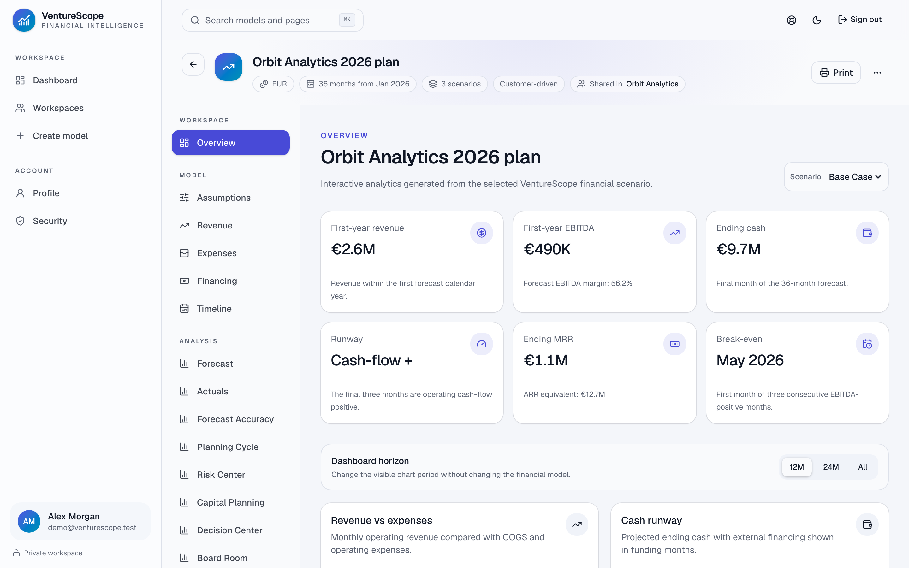
- **File:** screenshots/desktop/18-overview.png
- **Page:** /projects/:project/overview
- **Caption:** The overview of one model: key numbers and charts calculated from the assumptions.
- **What to notice:** The header shows currency, horizon, number of scenarios and revenue mode on every model page.
- **Alt text:** Model overview in VentureScope. The overview of one model: key numbers and charts calculated from the assumptions.
- **Other versions:** [Dark theme](../screenshots/dark/18-overview.png), [Phone](../screenshots/mobile/18-overview.png), [Full page](../screenshots/desktop/18-overview-full.png)

### 19. Assumptions
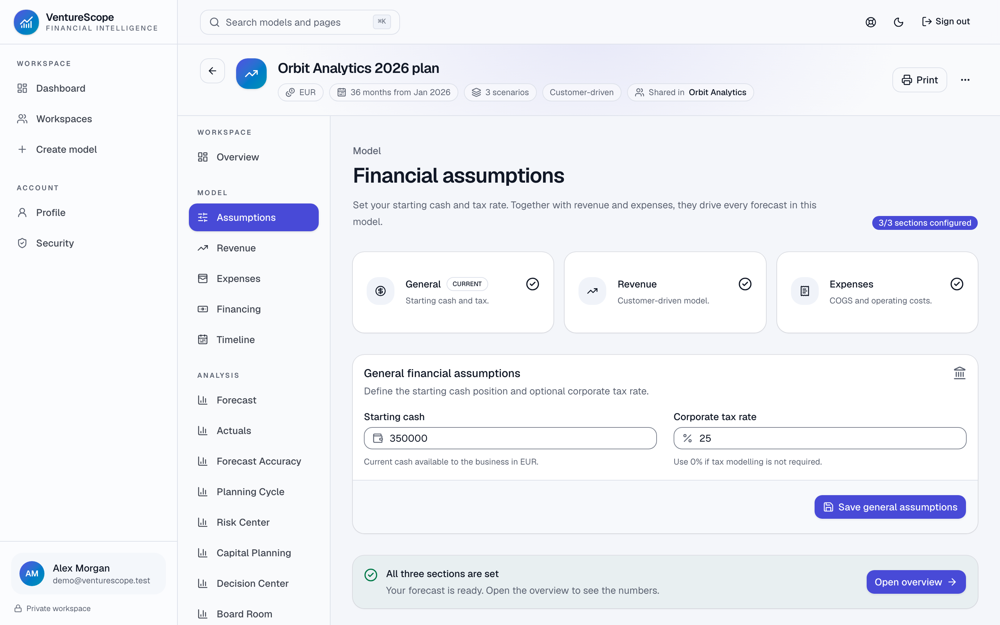
- **File:** screenshots/desktop/19-assumptions.png
- **Page:** /projects/:project/assumptions
- **Caption:** Starting cash, tax rate, cost of goods sold and operating costs. They drive every forecast.
- **What to notice:** One source of numbers: forecast, scenarios and reports all read these assumptions.
- **Alt text:** Assumptions in VentureScope. Starting cash, tax rate, cost of goods sold and operating costs. They drive every forecast.
- **Other versions:** none

### 20. Revenue assumptions
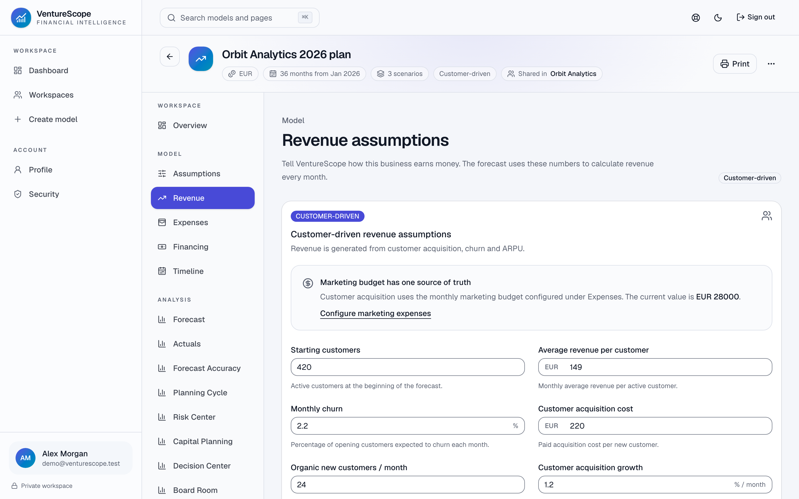
- **File:** screenshots/desktop/20-revenue.png
- **Page:** /projects/:project/revenue
- **Caption:** How the business earns money: customers, price per customer, churn, acquisition cost and organic sign-ups.
- **What to notice:** Fields accept numbers pasted from a spreadsheet.
- **Alt text:** Revenue assumptions in VentureScope. How the business earns money: customers, price per customer, churn, acquisition cost and organic sign-ups.
- **Other versions:** none

### 21. Expense assumptions
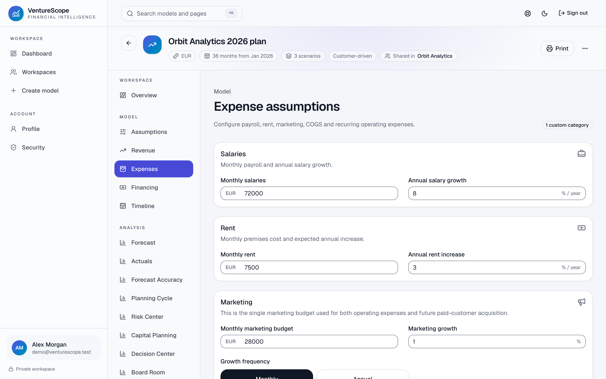
- **File:** screenshots/desktop/21-expenses.png
- **Page:** /projects/:project/expenses
- **Caption:** Payroll, rent, marketing, cost of goods sold and other recurring operating expenses.
- **What to notice:** Each cost is set on its own, so the forecast shows what drives the burn.
- **Alt text:** Expense assumptions in VentureScope. Payroll, rent, marketing, cost of goods sold and other recurring operating expenses.
- **Other versions:** none

### 22. Financing
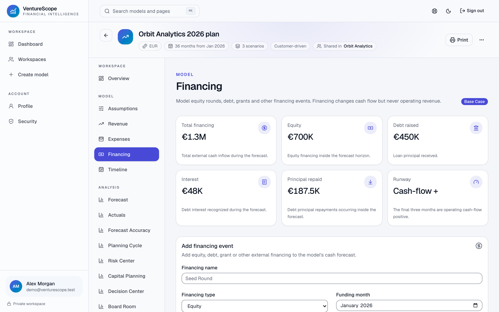
- **File:** screenshots/desktop/22-financing.png
- **Page:** /projects/:project/financing
- **Caption:** Equity rounds, debt, grants and other financing events. Financing changes cash flow, never operating revenue.
- **What to notice:** Financing events appear in the cash-flow forecast and the runway.
- **Alt text:** Financing in VentureScope. Equity rounds, debt, grants and other financing events. Financing changes cash flow, never operating revenue.
- **Other versions:** none

### 23. Planning timeline
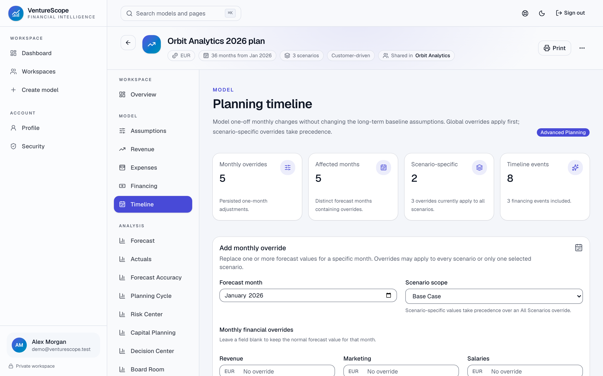
- **File:** screenshots/desktop/23-timeline.png
- **Page:** /projects/:project/timeline
- **Caption:** One-off monthly changes (overrides) without touching the long-term baseline.
- **What to notice:** Global overrides apply first, and scenario overrides take precedence.
- **Alt text:** Planning timeline in VentureScope. One-off monthly changes (overrides) without touching the long-term baseline.
- **Other versions:** none

## Forecast and analysis

### 24. Financial forecast
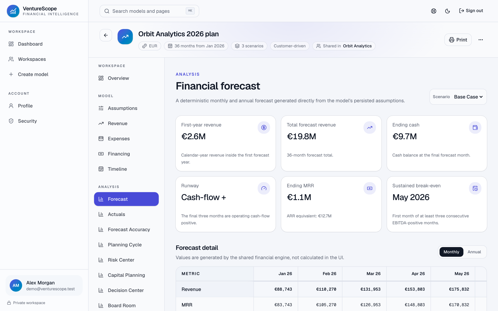
- **File:** screenshots/desktop/24-forecast.png
- **Page:** /projects/:project/forecast
- **Caption:** Monthly and annual forecasts generated from the assumptions by one deterministic engine.
- **What to notice:** P&L, cash flow and reports read the same forecast, so the numbers always agree.
- **Alt text:** Financial forecast in VentureScope. Monthly and annual forecasts generated from the assumptions by one deterministic engine.
- **Other versions:** [Dark theme](../screenshots/dark/24-forecast.png), [Phone](../screenshots/mobile/24-forecast.png), [Full page](../screenshots/desktop/24-forecast-full.png)

### 25. Profit and loss
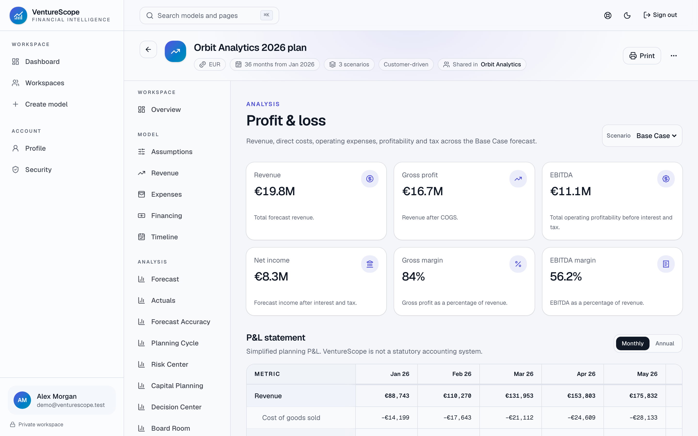
- **File:** screenshots/desktop/25-pnl.png
- **Page:** /projects/:project/pnl
- **Caption:** Revenue, gross profit, operating expenses, EBITDA and net income.
- **What to notice:** A table you can scroll sideways with the keyboard on a small screen.
- **Alt text:** Profit and loss in VentureScope. Revenue, gross profit, operating expenses, EBITDA and net income.
- **Other versions:** none

### 26. Cash flow
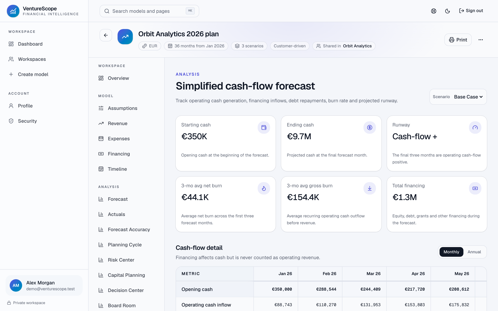
- **File:** screenshots/desktop/26-cash-flow.png
- **Page:** /projects/:project/cash-flow
- **Caption:** A simplified cash-flow forecast: operating cash flow, financing, debt repayment, burn and runway.
- **What to notice:** Runway shows how many months the cash lasts.
- **Alt text:** Cash flow in VentureScope. A simplified cash-flow forecast: operating cash flow, financing, debt repayment, burn and runway.
- **Other versions:** none

### 27. Customer analytics
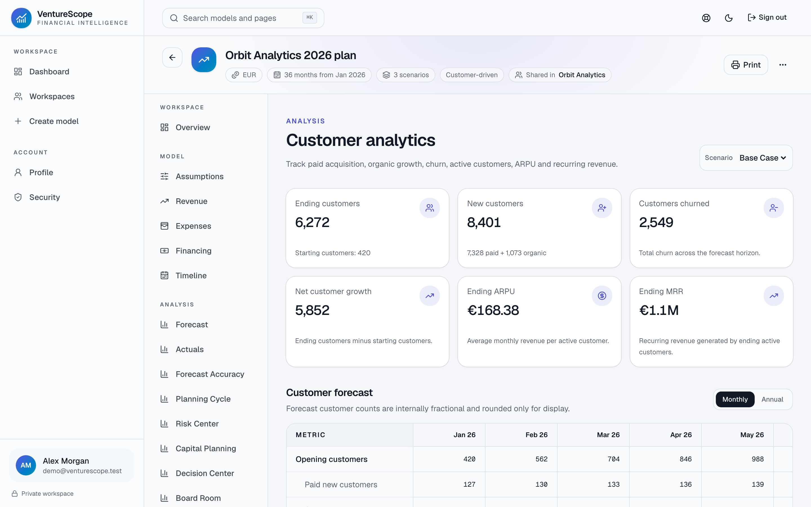
- **File:** screenshots/desktop/27-customers.png
- **Page:** /projects/:project/customers
- **Caption:** Acquisition, churn, active customers, price per customer and monthly recurring revenue.
- **What to notice:** The customer engine moves every month with acquisition and churn.
- **Alt text:** Customer analytics in VentureScope. Acquisition, churn, active customers, price per customer and monthly recurring revenue.
- **Other versions:** none

### 28. Scenario analysis
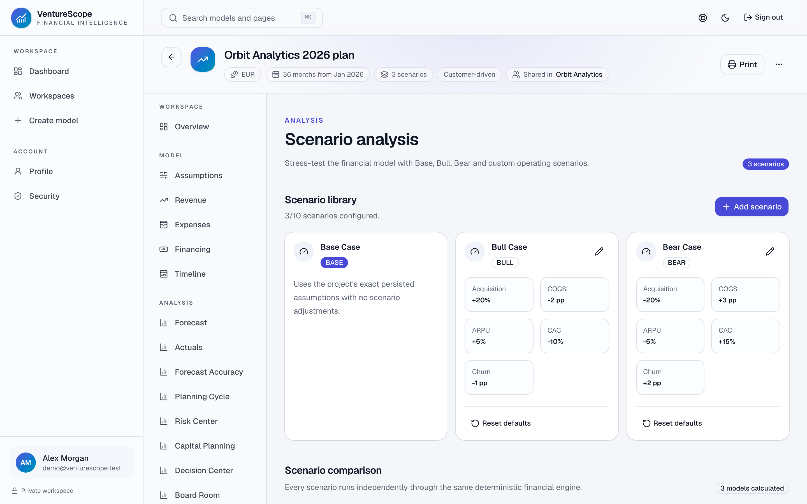
- **File:** screenshots/desktop/28-scenarios.png
- **Page:** /projects/:project/scenarios
- **Caption:** Stress-test the model with Base, Bull, Bear and custom scenarios.
- **What to notice:** Each scenario runs through the same engine. Only its modifiers differ.
- **Alt text:** Scenario analysis in VentureScope. Stress-test the model with Base, Bull, Bear and custom scenarios.
- **Other versions:** none

### 29. Scenario comparison
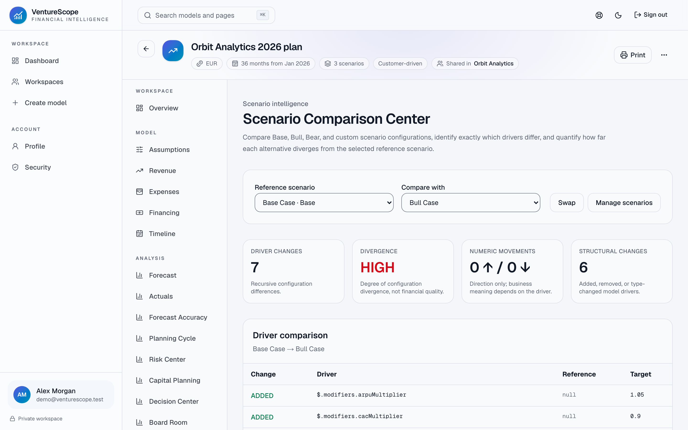
- **File:** screenshots/desktop/29-scenario-comparison.png
- **Page:** /projects/:project/scenario-comparison
- **Caption:** Compare scenarios side by side and see which drivers differ and how far each one is from the reference.
- **What to notice:** Pick any scenario as the reference.
- **Alt text:** Scenario comparison in VentureScope. Compare scenarios side by side and see which drivers differ and how far each one is from the reference.
- **Other versions:** [Full page](../screenshots/desktop/29-scenario-comparison-full.png)

### 30. Sensitivity lab
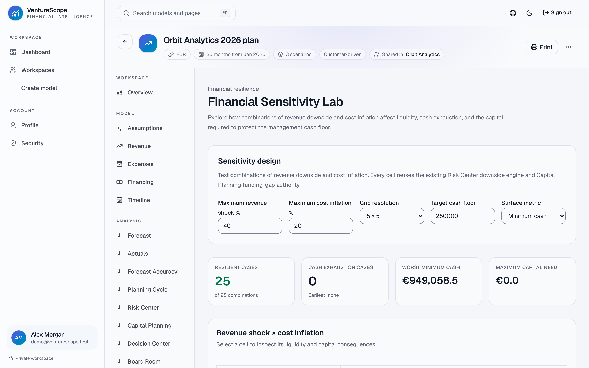
- **File:** screenshots/desktop/30-sensitivity-lab.png
- **Page:** /projects/:project/sensitivity-lab
- **Caption:** Explore combinations of revenue downside and cost inflation and what they do to liquidity and the cash floor.
- **What to notice:** Revenue downside and cost inflation are changed together, not one at a time.
- **Alt text:** Sensitivity lab in VentureScope. Explore combinations of revenue downside and cost inflation and what they do to liquidity and the cash floor.
- **Other versions:** [Full page](../screenshots/desktop/30-sensitivity-lab-full.png)

### 31. Advanced analytics
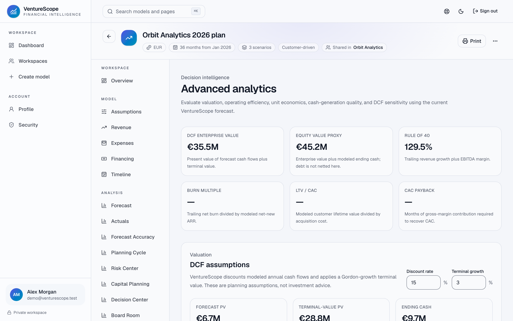
- **File:** screenshots/desktop/31-analytics.png
- **Page:** /projects/:project/analytics
- **Caption:** Valuation, operating efficiency, unit economics, cash-generation quality and DCF sensitivity.
- **What to notice:** All figures come from the current forecast.
- **Alt text:** Advanced analytics in VentureScope. Valuation, operating efficiency, unit economics, cash-generation quality and DCF sensitivity.
- **Other versions:** [Full page](../screenshots/desktop/31-analytics-full.png)

## Actuals and control

### 32. Actuals vs forecast
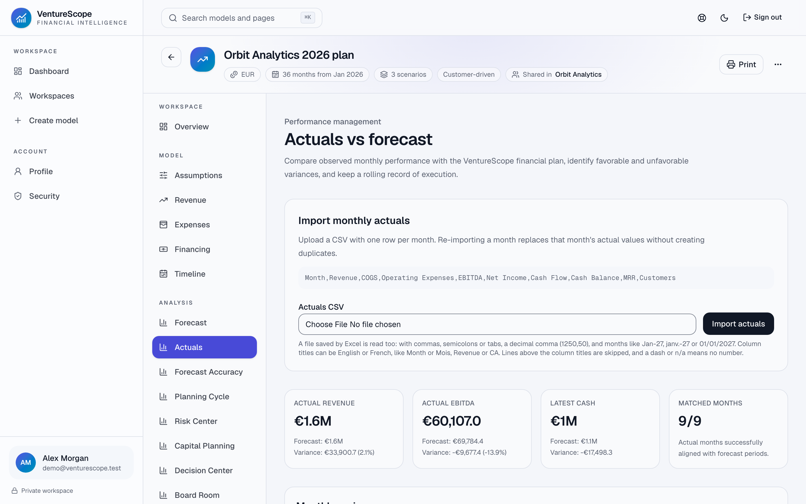
- **File:** screenshots/desktop/32-actuals.png
- **Page:** /projects/:project/actuals
- **Caption:** Actual monthly results against the plan, with favorable and unfavorable variances.
- **What to notice:** The demo has nine months of results, and the newest month has just ended.
- **Alt text:** Actuals vs forecast in VentureScope. Actual monthly results against the plan, with favorable and unfavorable variances.
- **Other versions:** [Dark theme](../screenshots/dark/32-actuals.png), [Full page](../screenshots/desktop/32-actuals-full.png)

### 33. Forecast accuracy
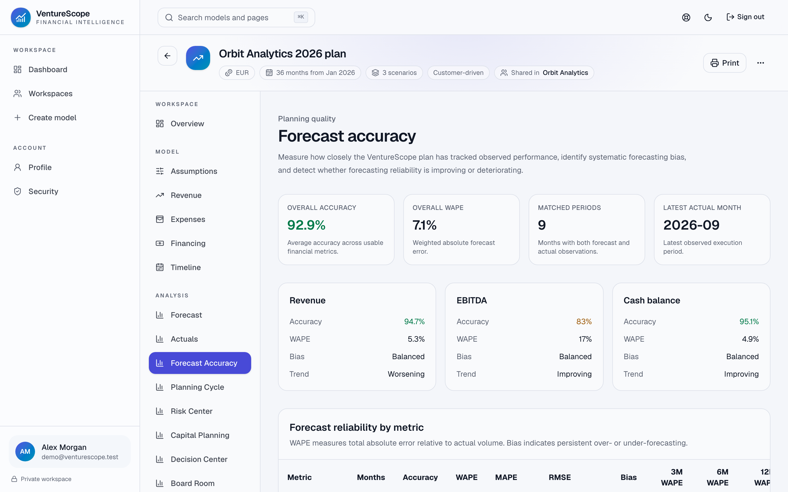
- **File:** screenshots/desktop/33-forecast-accuracy.png
- **Page:** /projects/:project/forecast-accuracy
- **Caption:** How closely the plan tracked reality, whether the forecast is biased, and whether it is getting better.
- **What to notice:** Bias shows if the plan is too low or too high month after month.
- **Alt text:** Forecast accuracy in VentureScope. How closely the plan tracked reality, whether the forecast is biased, and whether it is getting better.
- **Other versions:** none

### 34. Variance review
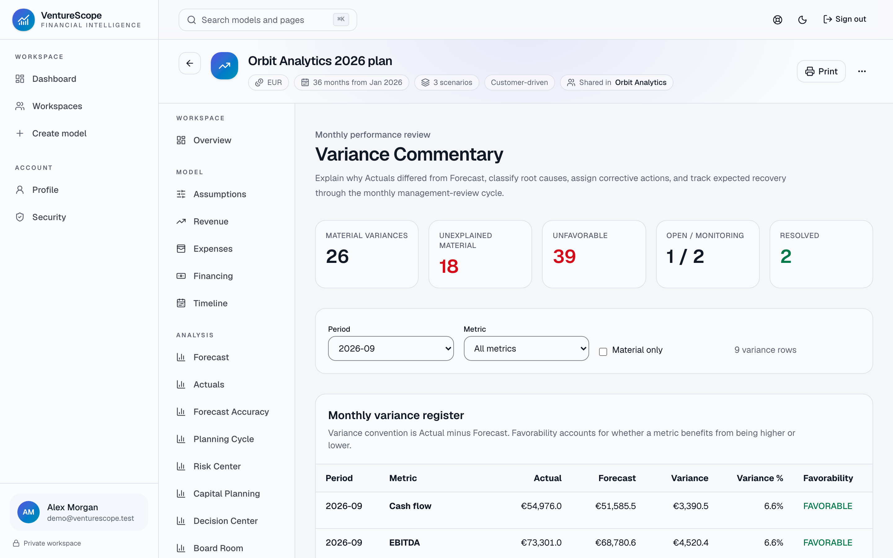
- **File:** screenshots/desktop/34-variance-review.png
- **Page:** /projects/:project/variance-review
- **Caption:** Explain why actuals differed from the forecast, classify root causes and track corrective actions.
- **What to notice:** Commentary is linked to the month it explains.
- **Alt text:** Variance review in VentureScope. Explain why actuals differed from the forecast, classify root causes and track corrective actions.
- **Other versions:** none

### 35. KPI scorecard
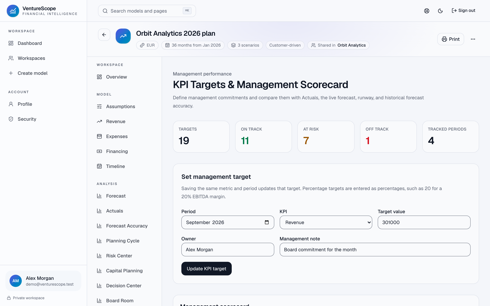
- **File:** screenshots/desktop/35-scorecard.png
- **Page:** /projects/:project/scorecard
- **Caption:** KPI targets compared with actuals, the live forecast, runway and past forecast accuracy.
- **What to notice:** Targets are goals set by management, not forecasts.
- **Alt text:** KPI scorecard in VentureScope. KPI targets compared with actuals, the live forecast, runway and past forecast accuracy.
- **Other versions:** [Full page](../screenshots/desktop/35-scorecard-full.png)

### 36. Financial close
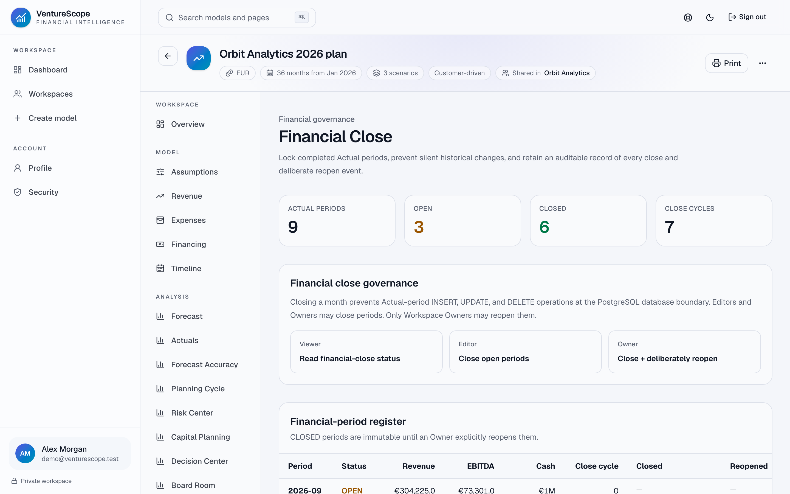
- **File:** screenshots/desktop/36-period-close.png
- **Page:** /projects/:project/period-close
- **Caption:** Lock finished months so numbers cannot change silently, and keep a record of every close and reopen.
- **What to notice:** The demo closes the first six months and reopens one with an approval.
- **Alt text:** Financial close in VentureScope. Lock finished months so numbers cannot change silently, and keep a record of every close and reopen.
- **Other versions:** none

### 37. Data import center
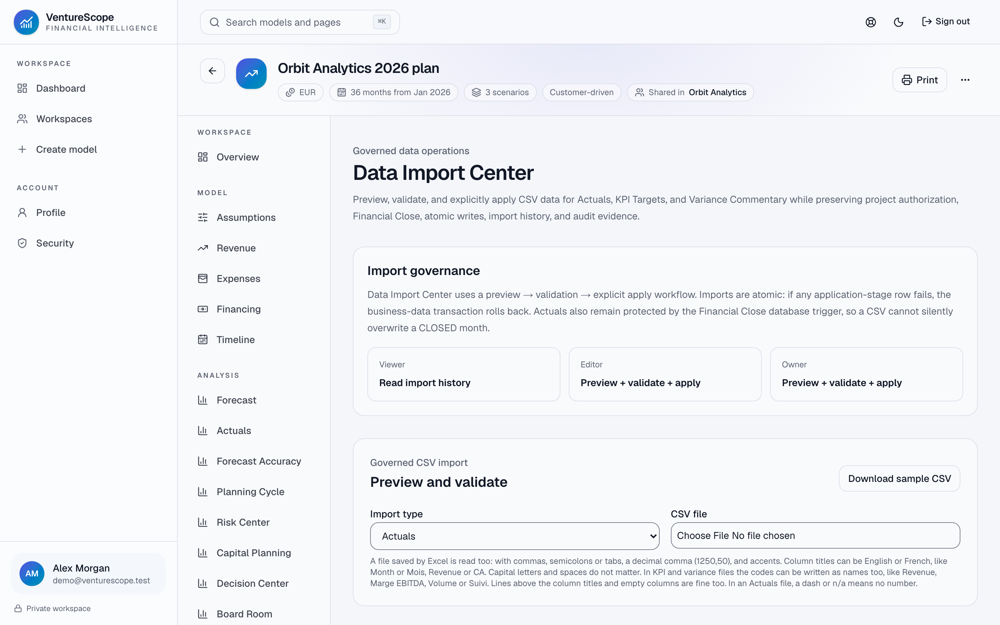
- **File:** screenshots/desktop/37-imports.png
- **Page:** /projects/:project/imports
- **Caption:** Preview, validate and apply CSV files for actuals, KPI targets and variance comments, with an import history.
- **What to notice:** A file is checked before anything is written, and the history shows what was loaded.
- **Alt text:** Data import center in VentureScope. Preview, validate and apply CSV files for actuals, KPI targets and variance comments, with an import history.
- **Other versions:** none

## Planning and risk

### 38. Planning cycle
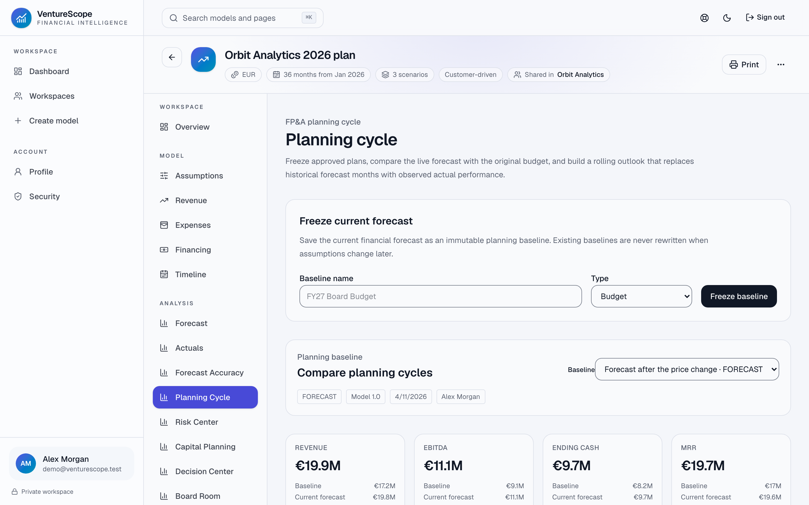
- **File:** screenshots/desktop/38-planning-cycle.png
- **Page:** /projects/:project/planning-cycle
- **Caption:** Freeze approved plans as baselines, compare them with the live forecast and build a rolling outlook from actuals.
- **What to notice:** The demo has two baselines: the original budget and the forecast after the price change.
- **Alt text:** Planning cycle in VentureScope. Freeze approved plans as baselines, compare them with the live forecast and build a rolling outlook from actuals.
- **Other versions:** [Full page](../screenshots/desktop/38-planning-cycle-full.png)

### 39. Liquidity risk center
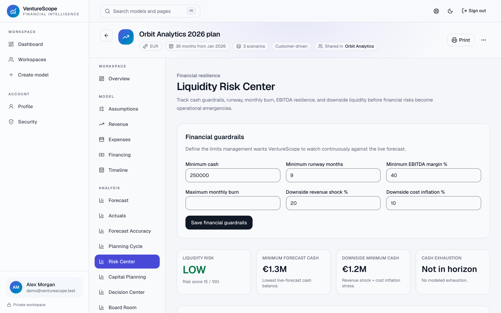
- **File:** screenshots/desktop/39-risk-center.png
- **Page:** /projects/:project/risk-center
- **Caption:** Cash guardrails, runway, monthly burn, EBITDA resilience and downside liquidity.
- **What to notice:** Rules set by the company turn the numbers into clear warnings.
- **Alt text:** Liquidity risk center in VentureScope. Cash guardrails, runway, monthly burn, EBITDA resilience and downside liquidity.
- **Other versions:** [Dark theme](../screenshots/dark/39-risk-center.png), [Phone](../screenshots/mobile/39-risk-center.png), [Full page](../screenshots/desktop/39-risk-center-full.png)

### 40. Capital planning
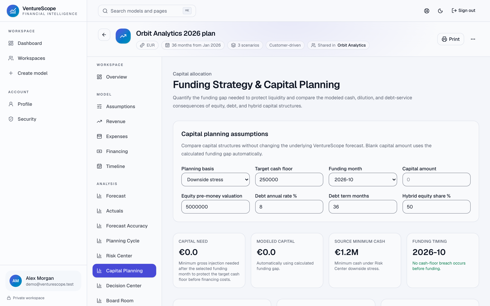
- **File:** screenshots/desktop/40-capital-planning.png
- **Page:** /projects/:project/capital-planning
- **Caption:** The size of the funding gap, and what equity, debt or a mix would do to cash, dilution and debt service.
- **What to notice:** Three funding structures are compared on the same page.
- **Alt text:** Capital planning in VentureScope. The size of the funding gap, and what equity, debt or a mix would do to cash, dilution and debt service.
- **Other versions:** [Full page](../screenshots/desktop/40-capital-planning-full.png)

### 41. Decision center
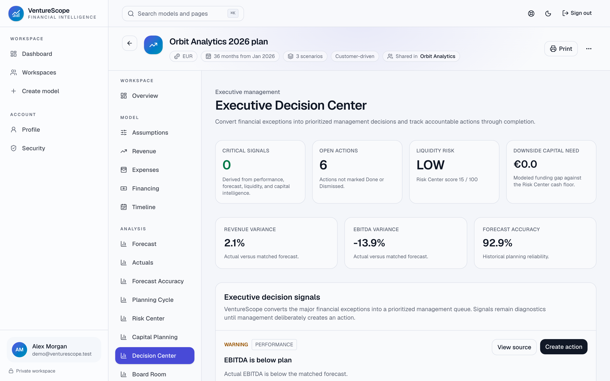
- **File:** screenshots/desktop/41-decision-center.png
- **Page:** /projects/:project/decision-center
- **Caption:** Turn financial exceptions into prioritized decisions with owners, due dates and statuses.
- **What to notice:** The demo has decisions in several statuses, such as open, in progress and blocked.
- **Alt text:** Decision center in VentureScope. Turn financial exceptions into prioritized decisions with owners, due dates and statuses.
- **Other versions:** none

### 42. Planning templates
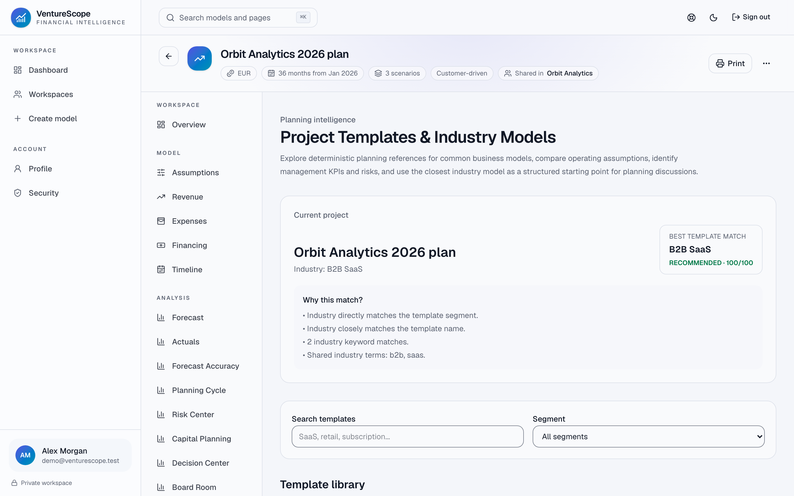
- **File:** screenshots/desktop/42-templates.png
- **Page:** /projects/:project/templates
- **Caption:** Industry reference models to compare assumptions, KPIs and risks for common business types.
- **What to notice:** A starting point for a planning talk, not a prediction.
- **Alt text:** Planning templates in VentureScope. Industry reference models to compare assumptions, KPIs and risks for common business types.
- **Other versions:** none

## Governance

### 43. Approval center
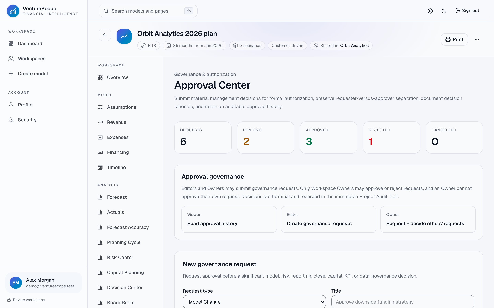
- **File:** screenshots/desktop/43-approvals.png
- **Page:** /projects/:project/approvals
- **Caption:** Formal approval of important decisions, with separate requester and approver and a recorded reason.
- **What to notice:** The demo has requests that are approved, rejected and still waiting.
- **Alt text:** Approval center in VentureScope. Formal approval of important decisions, with separate requester and approver and a recorded reason.
- **Other versions:** [Phone](../screenshots/mobile/43-approvals.png)

### 44. Activity center
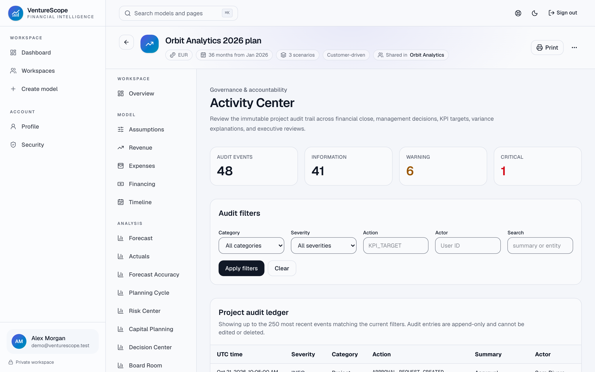
- **File:** screenshots/desktop/44-activity.png
- **Page:** /projects/:project/activity
- **Caption:** An unchangeable audit trail of closes, decisions, targets, comments and reviews.
- **What to notice:** Events are spread over the whole story, because each one is written on its own day.
- **Alt text:** Activity center in VentureScope. An unchangeable audit trail of closes, decisions, targets, comments and reviews.
- **Other versions:** [Dark theme](../screenshots/dark/44-activity.png), [Full page](../screenshots/desktop/44-activity-full.png)

### 45. Version history
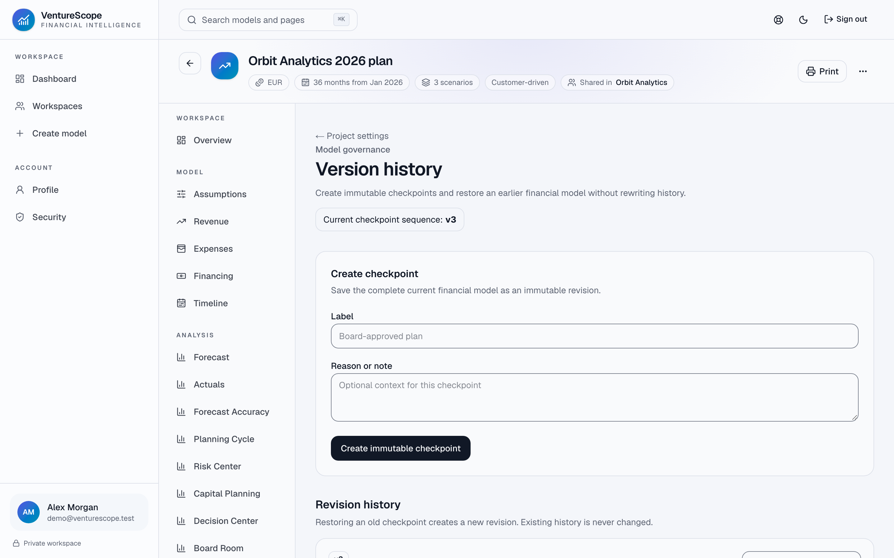
- **File:** screenshots/desktop/45-versions.png
- **Page:** /projects/:project/versions
- **Caption:** Save checkpoints and restore an earlier model without rewriting history.
- **What to notice:** The demo has three saved versions: Seed plan, Pricing update and Retention programme.
- **Alt text:** Version history in VentureScope. Save checkpoints and restore an earlier model without rewriting history.
- **Other versions:** none

### 46. Model diff
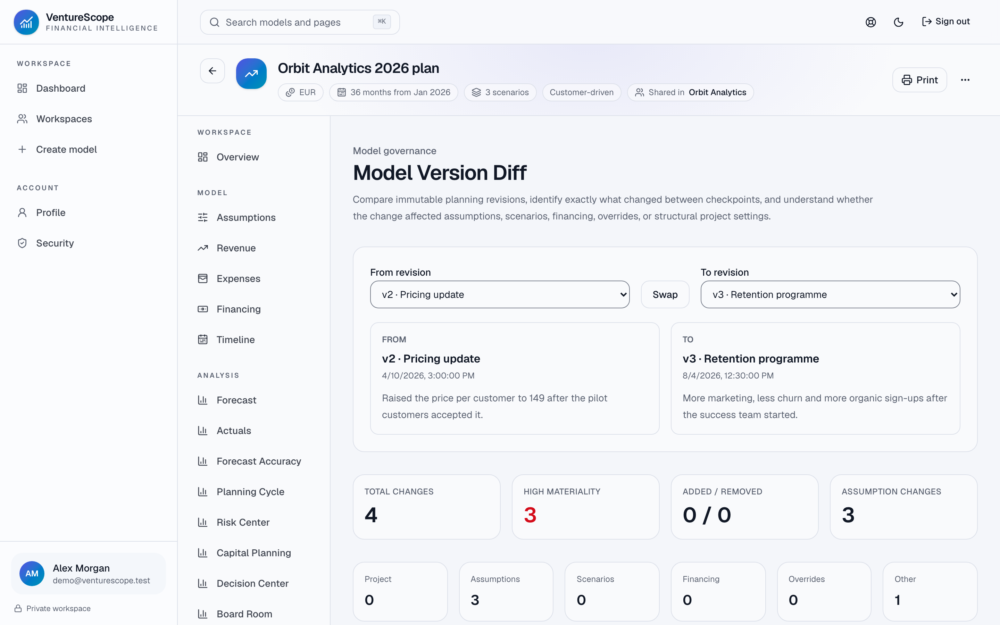
- **File:** screenshots/desktop/46-version-diff.png
- **Page:** /projects/:project/version-diff
- **Caption:** Compare two saved versions and see exactly what changed: assumptions, scenarios, financing or settings.
- **What to notice:** The result tells which part of the model changed.
- **Alt text:** Model diff in VentureScope. Compare two saved versions and see exactly what changed: assumptions, scenarios, financing or settings.
- **Other versions:** none

### 47. Board room
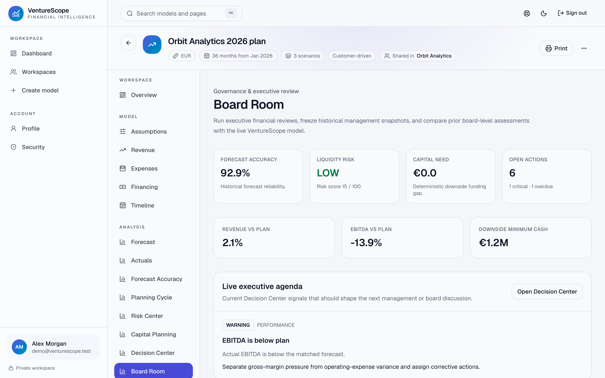
- **File:** screenshots/desktop/47-board-room.png
- **Page:** /projects/:project/board-room
- **Caption:** Run executive reviews, freeze a snapshot of the numbers and compare it later with the live model.
- **What to notice:** The demo has a frozen board review of the latest month.
- **Alt text:** Board room in VentureScope. Run executive reviews, freeze a snapshot of the numbers and compare it later with the live model.
- **Other versions:** [Dark theme](../screenshots/dark/47-board-room.png), [Full page](../screenshots/desktop/47-board-room-full.png)

### 48. Board pack
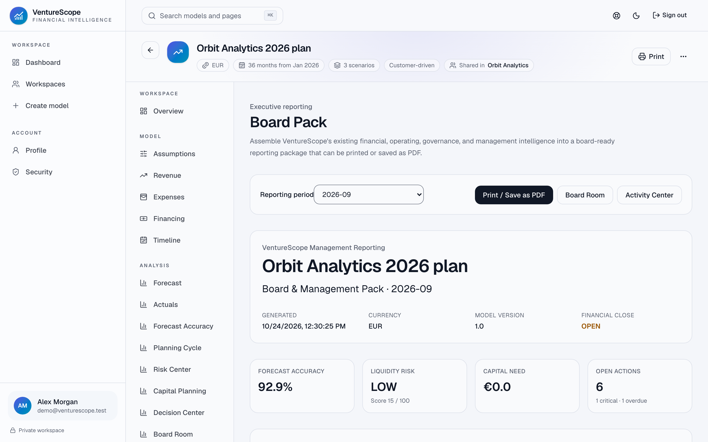
- **File:** screenshots/desktop/48-board-pack.png
- **Page:** /projects/:project/board-pack
- **Caption:** A board-ready report package that can be printed or saved as a PDF.
- **What to notice:** The page is built for print, so the menus disappear on paper.
- **Alt text:** Board pack in VentureScope. A board-ready report package that can be printed or saved as a PDF.
- **Other versions:** [Full page](../screenshots/desktop/48-board-pack-full.png)

### 49. Alert inbox
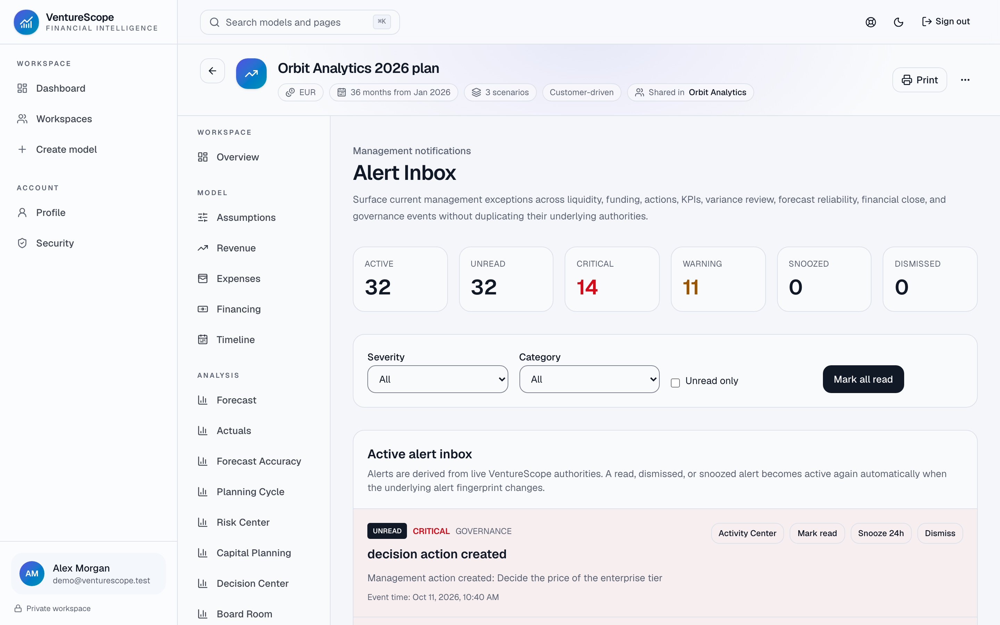
- **File:** screenshots/desktop/49-alerts.png
- **Page:** /projects/:project/alerts
- **Caption:** Current management exceptions about liquidity, funding, KPIs, close and governance in one list.
- **What to notice:** The inbox collects signals from other pages and does not repeat their calculations.
- **Alt text:** Alert inbox in VentureScope. Current management exceptions about liquidity, funding, KPIs, close and governance in one list.
- **Other versions:** none

## Portfolio and output

### 50. Portfolio dashboard
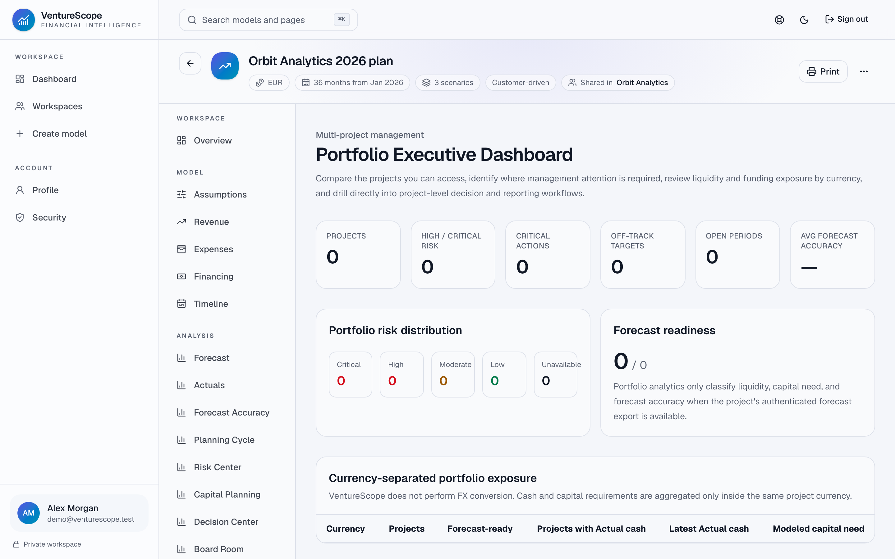
- **File:** screenshots/desktop/50-portfolio.png
- **Page:** /projects/:project/portfolio
- **Caption:** Compare the models you can access, see where attention is needed and the liquidity by currency.
- **What to notice:** Every row opens the decision or reporting page of that model.
- **Alt text:** Portfolio dashboard in VentureScope. Compare the models you can access, see where attention is needed and the liquidity by currency.
- **Other versions:** [Full page](../screenshots/desktop/50-portfolio-full.png)

### 51. Consolidation center

- **File:** screenshots/desktop/51-consolidation.png
- **Page:** /projects/:project/consolidation
- **Caption:** Convert and add up the models of a workspace in one reporting currency, with dated exchange rates entered by hand.
- **What to notice:** Missing rates are shown clearly, never guessed.
- **Alt text:** Consolidation center in VentureScope. Convert and add up the models of a workspace in one reporting currency, with dated exchange rates entered by hand.
- **Other versions:** none

### 52. Executive report

- **File:** screenshots/desktop/52-reports.png
- **Page:** /projects/:project/reports
- **Caption:** A report with CSV and PDF export, made without any paid service.
- **What to notice:** Sample exports are saved in the exports folder of the portfolio.
- **Alt text:** Executive report in VentureScope. A report with CSV and PDF export, made without any paid service.
- **Other versions:** [Full page](../screenshots/desktop/52-reports-full.png)

### 53. Release readiness

- **File:** screenshots/desktop/53-release-readiness.png
- **Page:** /projects/:project/release-readiness
- **Caption:** A read-only page with the capability map, governance controls and the expectations for a production release.
- **What to notice:** It shows what the product can do and how it is controlled, in one place.
- **Alt text:** Release readiness in VentureScope. A read-only page with the capability map, governance controls and the expectations for a production release.
- **Other versions:** none

### 54. Model settings

- **File:** screenshots/desktop/54-settings.png
- **Page:** /projects/:project/settings
- **Caption:** Model details, structure settings and explicit operations such as sharing, copying and deleting.
- **What to notice:** Dangerous actions ask for confirmation.
- **Alt text:** Model settings in VentureScope. Model details, structure settings and explicit operations such as sharing, copying and deleting.
- **Other versions:** none
